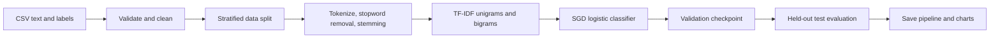

# Text Sentiment Analysis with TF-IDF and SGD Classifier

**English-language sentiment classification** into **positive**, **negative**, and **neutral** categories, using a traditional machine-learning pipeline built with Python and scikit-learn.

The project covers text preparation, exploratory data analysis (EDA), stratified train/validation/test splits, TF-IDF features, model training, performance evaluation, and inference on new text.

## Project at a glance

| Category | Details |
| --- | --- |
| Task | Multiclass sentiment classification |
| Input | English text (e.g., short social-media posts) |
| Labels | `positive`, `negative`, `neutral` |
| Text features | TF-IDF with unigram and bigram features |
| Classifier | `SGDClassifier(loss="log_loss")` with elastic-net regularization |
| Data split | 70% training / 15% validation / 15% testing (stratified) |
| Evaluation | Accuracy, macro F1, precision, recall, confusion matrix, ROC/AUC |
| Main tools | Python, pandas, NumPy, scikit-learn, NLTK, Matplotlib |

## Workflow



### Dataset format

The dataset is **not bundled with this repository**. Provide a CSV file with at least the following columns:

| text | sentiment |
| --- | --- |
| I really enjoyed this experience. | positive |
| The event starts at five. | neutral |
| This was disappointing. | negative |

These are illustrative rows, **not excerpts from the dataset**. An optional `id` column may be present; it is ignored because it is not a useful text feature.

Save the CSV as **`data/data.csv`** using UTF-8 encoding. The dataset shown during the project includes `id`, `sentiment`, and `text` columns. CSV data and model artifacts are intentionally excluded from version control. Use the data only if you have permission to publish or redistribute it; otherwise, keep it local and document its provenance when known.

> **Note:** The repository does not include the original CSV, so recorded evaluation metrics are not presented as independently reproduced results. Run the provided code on the full CSV to obtain your own metrics and plots.

## Repository structure

```text
sentiment-analysis-github/
├── README.md
├── notebooks/
│   └── sentiment_analysis.ipynb  # Walkthrough and visualizations
├── src/
│   ├── __init__.py
│   └── sentiment.py              # Data loading, modeling, plotting
├── data/
│   └── .gitkeep                  # Put data.csv here locally
├── train.py                      # Training and evaluation CLI
├── predict.py                    # Predict on a new sentence
├── tests/
│   └── test_pipeline.py
├── .github/workflows/tests.yml   # Automated tests
├── requirements.txt
├── requirements-dev.txt
├── .gitignore
└── GITHUB_AND_RESUME_TEXT.md
```

## Getting started

### 1. Set up your environment

Python 3.10 or newer is recommended.

```bash
git clone https://github.com/YOUR_USERNAME/YOUR_REPOSITORY.git
cd YOUR_REPOSITORY
python -m venv .venv
```

Activate the environment:

- macOS/Linux: `source .venv/bin/activate`
- Windows PowerShell: `.venv\Scripts\Activate.ps1`

Then install the dependencies:

```bash
pip install -r requirements.txt
```

### 2. Add the CSV

Put your file at `data/data.csv`. In Excel, use **Save As → CSV UTF-8 (Comma delimited)** and confirm that the header names are `text` and `sentiment` (an `id` column is fine). Alternatively, pass an absolute CSV path to the training command.

### 3. Run the Jupyter notebook

Start Jupyter from the repository root:

```bash
jupyter notebook notebooks/sentiment_analysis.ipynb
```

Execute the cells in order. The notebook displays class distributions, training curves, a confusion matrix, and one-vs-rest ROC curves. Its model-saving cell writes the trained pipeline to `artifacts/sentiment_model.joblib`.

### 4. Or train from the command line

```bash
python train.py --data data/data.csv --epochs 12
```

Outputs are written to the ignored `artifacts/` directory:

- `sentiment_model.joblib`: the entire fitted pipeline (TF-IDF + classifier)
- `metrics.json`: test metrics and the classification report
- `training_history.csv`: learning curves data
- `figures/`: class balance, learning curves, confusion matrix, and ROC plots

### 5. Predict sentiment for new text

```bash
python predict.py --text "I am happy with the result!"
```

This loads the saved model and prints its predicted class and estimated class probabilities. Those probabilities should not be interpreted as perfectly calibrated confidence scores.

## Methodology

1. **Validation:** Reads CSV, checks for `text` and `sentiment`, removes missing or blank entries, normalizes labels, and removes duplicate text rows to reduce data leakage. Where duplicate texts have conflicting labels, the first occurrence is retained, so those cases should be reviewed separately.
2. **Split:** Uses class-stratified training (70%), validation (15%), and test (15%) sets.
3. **Preprocessing:** Removes URLs, email addresses, and `@mentions`; tokenizes text; filters English stop words; applies Porter stemming.
4. **Vectorization:** Fits TF-IDF **only on training data**; uses unigram/bigram features and a 30,000-feature cap.
5. **Training:** Fits a regularized SGD linear classifier with logistic loss, tracking validation log loss over 12 passes (epochs) by default.
6. **Model selection:** Restores the fitted estimator from the epoch with the lowest validation log loss.
7. **Evaluation:** Reports held-out test accuracy, macro F1, class-wise precision/recall/F1, a confusion matrix, and ROC curves.
8. **Saving:** Serializes the full model pipeline for reproducible inference.

## Interpreting results

Accuracy alone can be misleading if one sentiment class is more common than the others. **Macro F1** gives equal weight to the three classes and is useful when evaluating performance on underrepresented classes. Inspect the classification report and confusion matrix to see which categories are being confused.

The final trained model and metrics will depend on the CSV contents, preprocessing decisions, package versions, and training configuration. **This repository does not claim a measured score until the training code is run on the actual dataset.**

## Limitations and possible improvements

- English-specific stop-word removal and stemming; not designed for Persian or other languages.
- A bag-of-words model cannot capture sarcasm or complex word order as well as modern contextual models.
- If classes are imbalanced, minority-class recall may be relatively low.
- Deduplication retains the first label if identical texts have conflicting annotations.
- Evaluate different regularization settings, character n-grams, class weighting, and calibration using validation data; never tune against the test set.
- For a larger study, compare with baselines (majority class, Naive Bayes, or Linear SVM), and consider transformer-based models.

## Tests

Tests use small **synthetic** sentences; no original dataset is required.

```bash
pip install -r requirements-dev.txt
python -m pytest -q
```

## Reproducibility and responsible use

Random seeds are fixed for the data split and training order. The dataset source and license should be documented once available. Sentiment predictions are probabilistic estimates, not objective assessments of people or their intentions.

**Security:** Only load `joblib` model files that you trust, as deserializing untrusted files can run arbitrary code.
